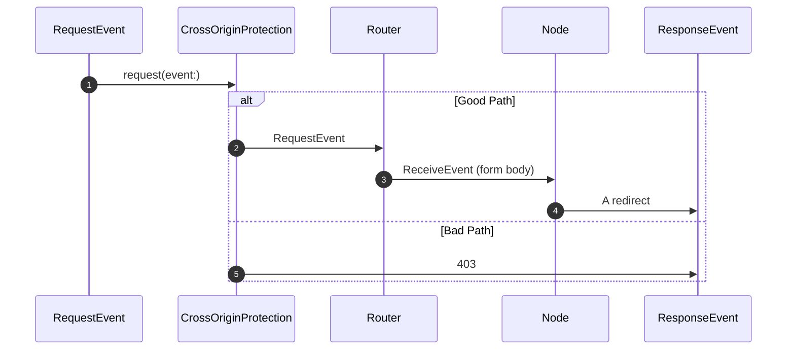

## Technical Case Study

Raindeer's architecture through the flow of a simple <a href='/docs/templating#forms'>form</a>:
```ruby
<{ form: '/submit' }>
  <input type="submit" value="Submit">
<{ :form }>
```

When the browser sends this form it makes a request, which goes through each part of Raindeer in turn:



**Each part of the request-response lifecycle has a single responsibility:**
- [Observers](/docs/observers#ordering) only knows about ordering
- [CrossOriginProtection](/docs/middleware#cross-origin-protection) only knows where a request came from
- [The router](/docs/routing) only worries about routing
- [LowNode](/docs/nodes) only knows how to answer the event it's given
- [Templates](/docs/templating#forms) only render the form

In other frameworks something like CrossOriginProtection would be mixed in with the router. With Raindeer and observers it's just another observer on a RequestEvent.

<p><a href="/docs/middleware#cross-origin-protection" role="button"><i class="bi bi-arrow-repeat"></i>See Middleware</a></p>
