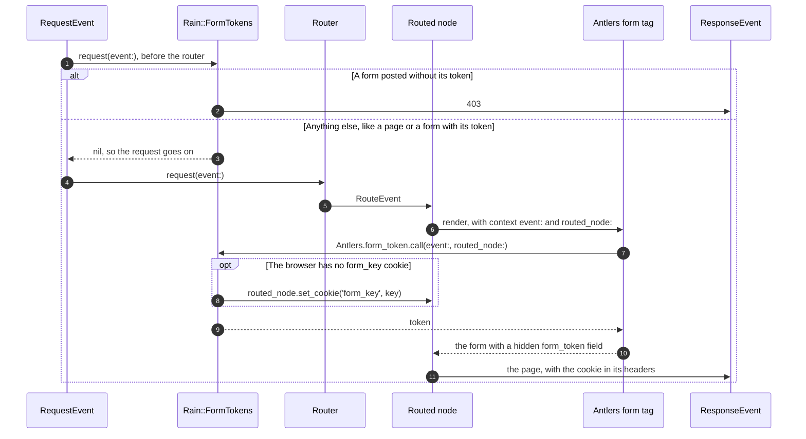

## Technical Case Study

Raindeer's architecture through the flow of a simple <a href='/docs/templating#forms'>form</a>:
```ruby
<{ form: '/submit' }>
  <input type="submit" value="Submit">
<{ :form }>
```

This form lives in a LowNode which returns a ResponseEvent. But you get to this form the browser makes a request; A RequestEvent.



**Each component is single responsibility:**
- The router only worries about routing
- Antlers only knows it's given a token, and hands on what its render context has
- Observers only knows about order
- LowNode only knows its render context, which has the routed node
- Raindeer only knows about requests, cookies and its secret

In other frameworks something like securing a form would ultimately be mixed in with the router, controller and view layers. With Raindeer and observers there is a clean seperation of concerns.

<p><a href="/docs/middleware" role="button"><i class="bi bi-arrow-repeat"></i>See Middleware</a></p>
