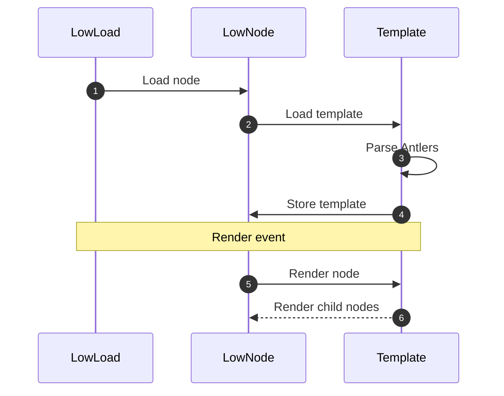

<{ :toc }>

## Syntax

[Antlers](https://github.com/raindeer-rb/antlers) uses two different sets of start and stop characters:
- 🦌 **Deerheads:** `<{` and `}>` - Allows HTML
- 🖇 **Brackets:** `{` and `}` -  **Escapes** HTML and can only render variables

Unlike other templating languages which use syntax to distinguish between control flow and output, there is no difference in Antlers. In Antlers all constructs render output, even if that output is an empty string (`''`).

## Variables

Access an instance variable with:
```ruby
def render
  <html>{@user}</html>
end
```

**Variables can evaluate:**
1. An instance variable: `{@instance_var}` or `<{ @instance_var }>`
2. A method call/local variable: `{method_or_var}` or `<{ method_or_var }>`
3. A method chain: `{method_or_var.method}` or `<{ method_or_var.method }>`
4. A string: `{"String"}` or `<{ "String" }>`

> [!WARNING]
> Quote Brackets in HTML attributes to avoid them being misinterpreted as Deerheads:
> 
> ❌ **Bad:** `<html class={var}>` - *"Oh no I see `}>`!"*
> ✅ **Good:** `<html class="{var}">` - *"Phew it's just `}`"*

## Components

Render a [node](/docs/nodes) named `UserNode` with:
```ruby
def render
  <html><{ UserNode }></html>
end
```

> [!IMPORTANT]
> The class referenced via `<{ MyNode }>` must implement a `render` instance method.

### Props

```ruby
def render
  <html><{ UserNode user=@user }></html>
end
```

The `UserNode` class definition would accept these props like:

```ruby
class UserNode < LowNode
  def render(event:, user:)
    <h1>{user.name}</h1>
  end
end
```

### Slots

```ruby
def render
  <html>
    <{ Layout: }>
      <{ UserNode user=@user }>
    <{ :Layout }>
  </html>
end
```

The `Layout` would look like:
```ruby
class Layout < LowNode
  def render(event:)
    <header>...</header>
    <{ :slot }>
    <footer>...</footer>
  end
end
```

## Conditionals

```ruby
# Block.
<{ if: @user.happy? }>
  <{ UserNode user=@user }>
<{ :if }>

# Directive. [UNRELEASED]
<{ UserNode user=@user if: @user.happy? }>
```

## Loops

### Array

```ruby
<{ for: user in: @users }>
  <{ UserNode user=user }>
<{ :for }>
```

### Hash

For a hash use `for: key, value` syntax.

```ruby
<{ for: id, user in: @users }>
  <{ UserNode id=id user=user }>
<{ :for }>
```

## Forms

Forms can be created in a compositional way, mixing both Antlers syntax with regular form elements:

```ruby
<{ form: '/submit' }>
  <input type="submit" value="Submit">
<{ :form }>
```

Antlers generates additional markup behind the scenes:
- Sets the form's `action` to `/submit`
- Sets the form's `method` to `POST`
- Adds a hidden `form_token` field, an anti-forgery token [UNRELEASED]

Change the `POST` method to `GET`, and give the form HTML attributes, with:

```ruby
<{ form: '/search' method: 'GET' class='search' }>
  <input type="search" name="q">
  <input type="submit" value="Search">
<{ :form }>
```

A GET form gets no token, as it shouldn't change anything.

### Anti-forgery tokens [UNRELEASED]

Another site can put a form on its page that posts to yours, and the browser sends your cookies with it, so a visitor who's logged in could be made to do something without knowing. Raindeer stops that for every form you make with `<{ form: }>`:

- Each browser gets a random key in a `form_key` cookie, and each POST form a token made from it with your app's secret. Another site can't read the cookie or know the secret, so it can't make the token.
- `Rain::FormTokens` observes `RequestEvent` before anything else, and answers a form posted without its token with a 403, so it never reaches your nodes.
- Only bodies a form on another site can send are checked: URL-encoded, multipart and plain text. A JSON body, like a webhook's, goes through as before.

Set the secret with `RAIN_SECRET`. Without it a random one lasts until the server restarts, so a form opened before a restart is turned away after it.

### Label [UNRELEASED]

`<{ label: 'Label' }>`

### Search [UNRELEASED]

`<{ search: :query }>`

### Submit [UNRELEASED]

`<{ submit: 'Search' }>`

## Parallelism [UNRELEASED]

Add parallelism where it makes sense and you can measure the performance outcome and keep data integrity.

**Per sibling:**
```ruby
def render
  # Both child nodes executed at the same time.
  <{ parallelize: }>
    <{ UserNode user=@user }>
    <{ PostsNode posts=@posts }>
  <{ :parallelize }>
end
```

**Per block:**
```ruby
def render
  # Each UserNode rendered at the same time.
  <{ map: user in: @users :parallelize }>
    <{ UserNode user=user }>
  <{ :map }>
end
```

**Per directive:**
```ruby
<{ UserNode user=user for: user in: @users :parallelize }>
```

## Translations

[Variables](#variables) are also useful for embedding text in RBX without any syntax highlighting issues:
```ruby
def render
  <html>{"I'm just a string"}</html>
end
```
Text entered this way can be translated based on region, language or any arbitrary condition. [UNRELEASED]

## Full Examples

### Slot

```ruby
class UserNode < LowNode
  def initialize
    @user = User.new(username: "Random User", bio: "I'm a person!")
  end
  
  def render
    <html>
      <{ Layout: title=@user.username }>
        {@user.bio}
      <{ :Layout }>
    </html>
  end
end
```

The `Layout` would look like:
```ruby
class Layout < LowNode
  def render(event:, title:)
    <header>...</header>
    <h1>{title}</h1>
    <{ :slot }>
    <footer>...</footer>
  end
end
```

The result would be:
```HTML
<header>...</header>
<h1>Random User</h1>
<p>I'm a person!</p>
<footer>...</footer>
```

## Architecture

Antlers creates an Abstract Syntax Tree composed of the following `AntlerNode`s:

**Leaf nodes:**
- `SoloNode`
- `VarNode`

**Branch nodes:**
- `RootNode`
- `SlotNode`
- `YieldNode` - Renders `AntlerNode`s inside a `SlotNode`


